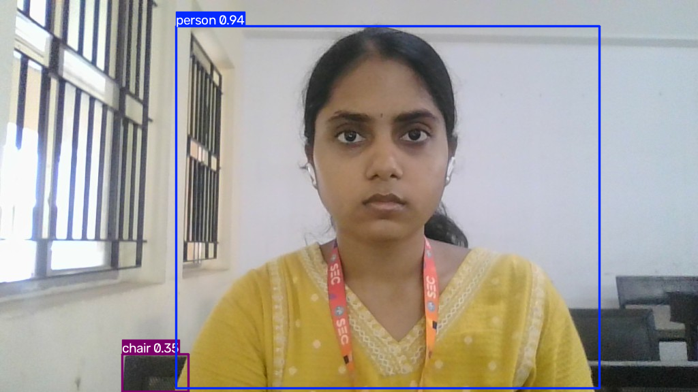
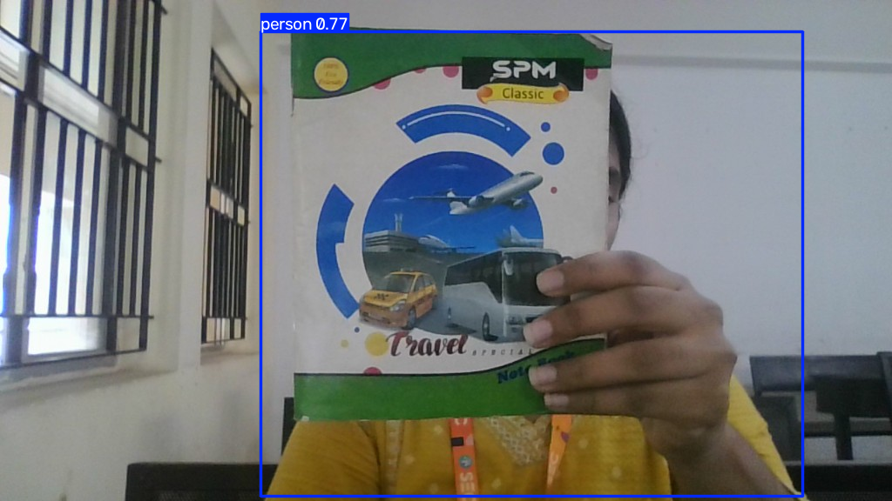
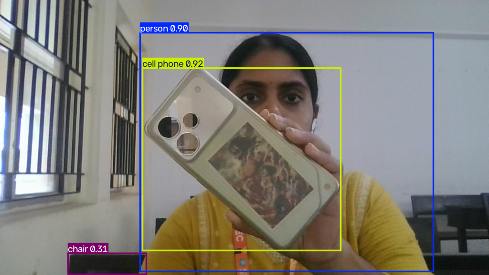

# Workshop 2: Object Detection Using the Web Camera

## Experiment Details

- **Name:** Ramitha Chowdary S
- **Register Number:** 212224240130

## Aim

Take three frames from the laptop camera and mark the objects in each one with YOLOv8.

## Software Required

- Anaconda, Python 3
- Jupyter Notebook
- OpenCV, Matplotlib, Ultralytics YOLOv8

## Algorithm

**Step 1:** Load the YOLOv8 nano model.

**Step 2:** Open the webcam and take three frames, waiting 5 seconds before each shot.

**Step 3:** Run detection on each frame and show the boxes with the labels.

## Program

#### 1.

`python
import time
import cv2
import matplotlib.pyplot as plt
from ultralytics import YOLO
`

#### 2.

`python
model = YOLO("yolov8n.pt")
`

#### 3.

`python
cap = cv2.VideoCapture(0)
frames = []
for shot in range(3):
    start = time.time()
    frame = None
    while time.time() - start < 5:
        ok, frame = cap.read()
        if not ok:
            break
    frames.append(frame)
cap.release()
`

#### 4.

`python
for shot, frame in enumerate(frames, 1):
    detected = model.predict(frame, verbose=False)[0]
    print(f"Scene {shot}")
    for box in detected.boxes:
        print(detected.names[int(box.cls)], round(float(box.conf), 2))
    drawn = detected.plot()
    cv2.imwrite(f"output/0{shot}-detected.png", drawn)
    plt.imshow(cv2.cvtColor(drawn, cv2.COLOR_BGR2RGB))
    plt.title(f"Detected Objects {shot}")
    plt.axis("off")
    plt.show()
`

## Output

## Result

Three frames from the laptop camera were passed through YOLOv8. The person was marked in each frame, and the phone was marked in the third.
