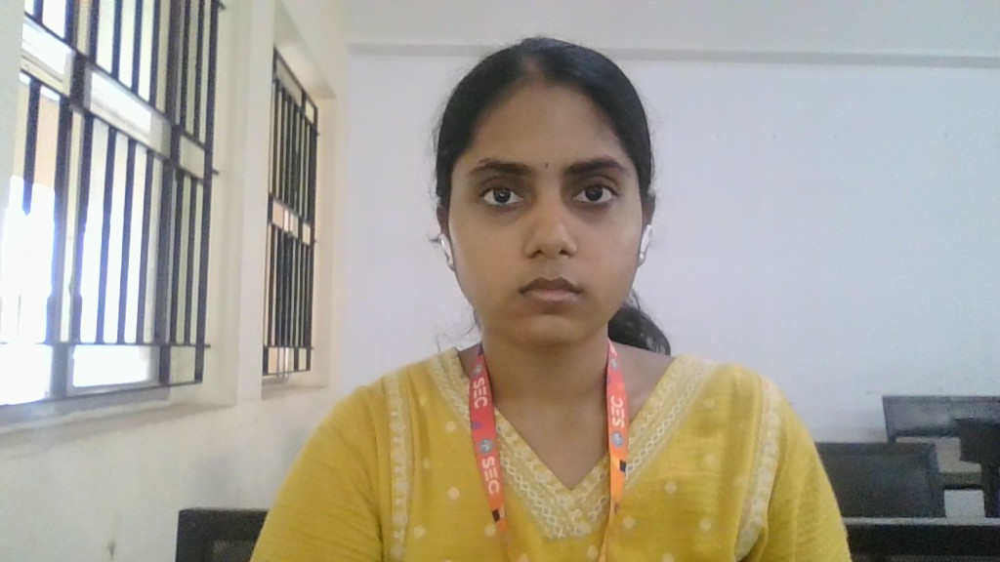

# Workshop 2: Object Detection Using the Web Camera

## Experiment Details

- **Name:** Ramitha Chowdary S
- **Register Number:** 212224240130

## Aim

Take one frame from the laptop camera, wait a few seconds before the shot, and mark the objects in it with YOLOv8.

## Software Required

- Anaconda, Python 3
- Jupyter Notebook
- OpenCV, Matplotlib, Ultralytics YOLOv8

## Algorithm

**Step 1:** Load the YOLOv8 nano model.

**Step 2:** Open the webcam, wait 5 seconds, and keep the latest frame.

**Step 3:** Run detection, print the labels, and show the boxes.

**Step 4:** Release the camera.

## Program

#### 1.

```python
import time
import cv2
import matplotlib.pyplot as plt
from ultralytics import YOLO
```

#### 2.

```python
model = YOLO("yolov8n.pt")
```

#### 3.

```python
cap = cv2.VideoCapture(0)
start = time.time()
frame = None
while time.time() - start < 5:
    ok, frame = cap.read()
    if not ok:
        break
cv2.imwrite("captured_frame.jpg", frame)
plt.imshow(cv2.cvtColor(frame, cv2.COLOR_BGR2RGB))
plt.title("Captured Frame")
plt.axis("off")
plt.show()
```

#### 4.

```python
detected = model.predict(frame, verbose=False)[0]
for box in detected.boxes:
    name = detected.names[int(box.cls)]
    print(name, round(float(box.conf), 2))
annotated = detected.plot()
cv2.imwrite("output/02-detected.png", annotated)
plt.imshow(cv2.cvtColor(annotated, cv2.COLOR_BGR2RGB))
plt.title("Detected Objects")
plt.axis("off")
plt.show()
```

#### 5.

```python
cap.release()
```

## Output




## Result

A frame from the laptop camera was passed through YOLOv8 and the objects were drawn with their labels.
